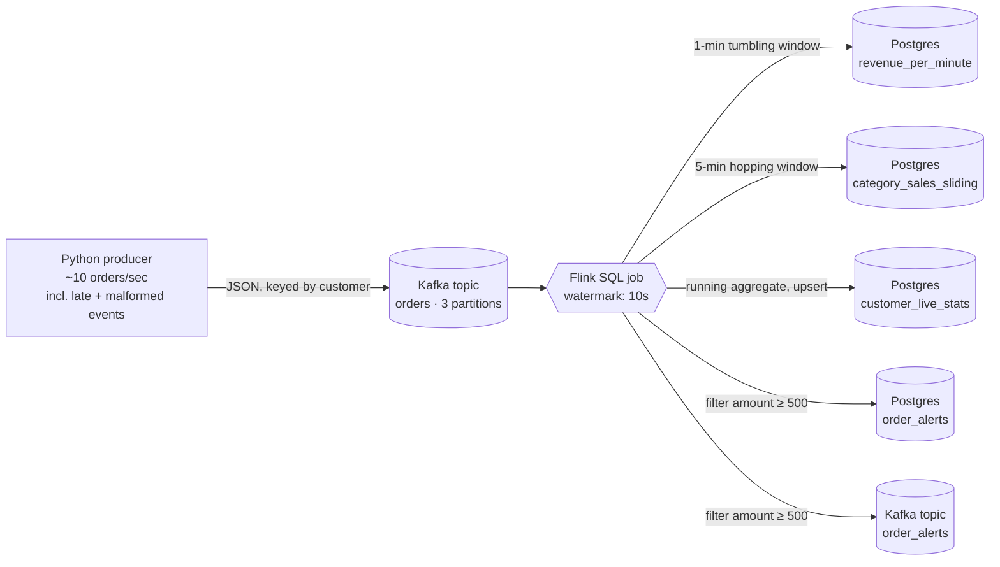
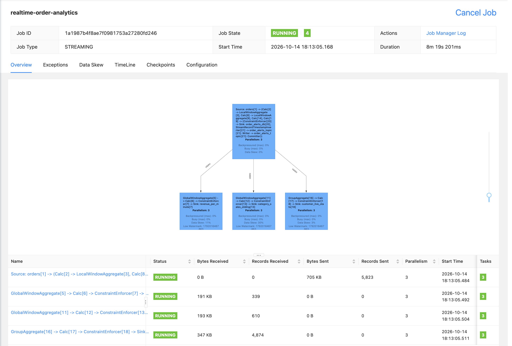
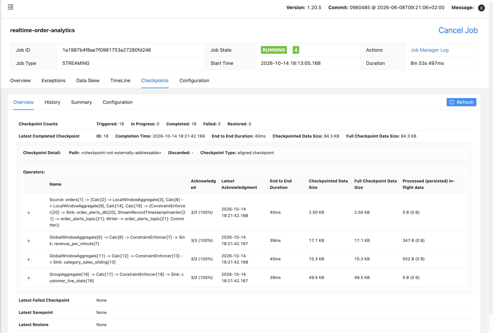
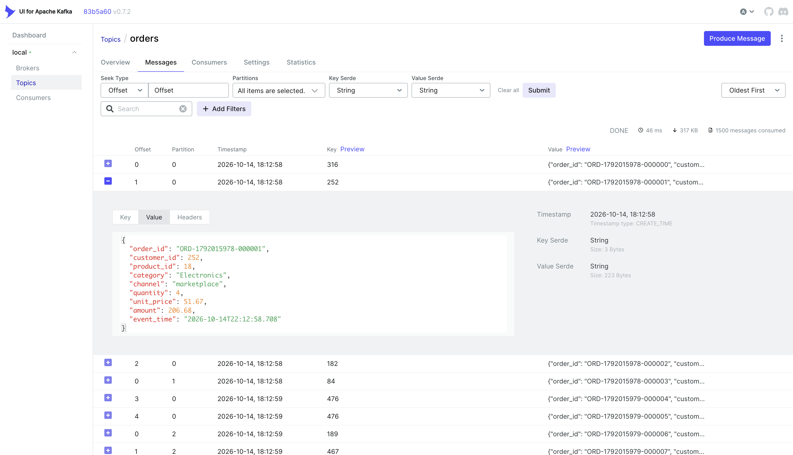
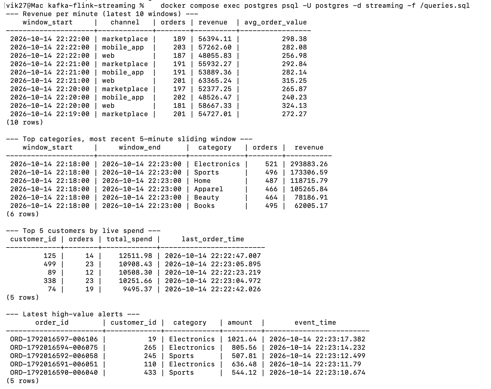

# Real-Time Order Analytics with Kafka + Flink SQL


A streaming pipeline that processes e-commerce orders **as they happen**. A Python producer
streams order events into **Apache Kafka**; an **Apache Flink SQL** job computes windowed KPIs,
live per-customer aggregates and high-value-order alerts with **event-time watermarks**, and
writes results to **PostgreSQL** (upserts) and back to Kafka. Everything runs in Docker, and the
Flink SQL is covered by automated tests in **GitHub Actions**.

## Architecture


## Screenshots

**Flink: one job, Kafka source fanned out to five streaming pipelines**


**Flink checkpoints: fault tolerance with 30-second checkpoints**


**Kafka: live order events on the `orders` topic**


**Results in Postgres: windowed revenue, sliding category sales, live customer stats, alerts**


## What the Flink job does

All five pipelines run as **one Flink job** (a statement set), so Kafka is read once and
fanned out to every query. The job is defined entirely in SQL under [`flink/sql/`](flink/sql).

| Pipeline | Flink concept | Output |
|---|---|---|
| Revenue per channel per minute | `TUMBLE` window | `realtime.revenue_per_minute` |
| Last 5 minutes of sales per category, refreshed every minute | `HOP` (sliding) window | `realtime.category_sales_sliding` |
| Lifetime orders and spend per customer | Stateful `GROUP BY` producing an update stream → JDBC upsert | `realtime.customer_live_stats` |
| High-value order alerts | Streaming filter, dual sink | `realtime.order_alerts` + Kafka `order_alerts` |

## Design decisions

- **Event time, not processing time.** Windows use each order's `event_time`, with a 10-second
  watermark, so results are correct even when events arrive out of order. The producer sends
  ~5% late events on purpose; events later than the watermark are dropped from windows.
- **Partitioning by customer.** Messages are keyed by `customer_id`, so each customer's orders
  stay in order within one partition. Flink parallelism (3) matches the partition count.
- **Idempotent sinks.** Every Postgres table has a primary key, so the JDBC connector upserts
  (`INSERT ... ON CONFLICT DO UPDATE`). Replays after a failure never duplicate rows.
- **Fault tolerance.** Checkpoints every 30 seconds let the job resume from Kafka offsets
  after a restart; the Kafka alerts sink is at-least-once.
- **Bad data doesn't stop the stream.** ~1% of events are malformed JSON;
  `json.ignore-parse-errors` skips them instead of failing the job.
- **Safe redeploys.** The submit script checks whether the job is already running, so
  re-running `docker compose up` never starts a duplicate job.
- **Tested SQL.** The tests run the real SQL files on a local Flink engine and check results
  against a plain-Python calculation, including a test proving the watermark drops a very late event.

## Run it locally

**Prerequisites:** Docker Desktop with at least **6 GB of memory** (Settings → Resources).

```bash
git clone https://github.com/vikramdata/kafka-flink-streaming.git
cd kafka-flink-streaming
docker compose up -d --build
```

The first build takes a few minutes. Then open:

| What | Where |
|---|---|
| **Flink web UI**: running job, operator graph, checkpoints | http://localhost:8081 |
| **Kafka UI**: topics, partitions, live messages | http://localhost:8082 |
| **Postgres** results | `localhost:5434`, database `streaming`, user and password `postgres` |

Windows only close once the watermark passes them, so give it **2–3 minutes** before the
first windowed results appear. Then run the sample queries:

```bash
docker compose exec postgres psql -U postgres -d streaming -f /queries.sql
```

Useful commands:

```bash
docker compose logs -f producer          # watch events being sent
docker compose logs flink-sql-runner     # see the job submission
docker compose down                      # stop (keeps data)
docker compose down -v                   # stop and delete all data
```

## Run the tests

```bash
python3.11 -m venv .venv && source .venv/bin/activate    # PyFlink needs Python 3.9–3.11 and Java 11/17
pip install -r requirements-dev.txt
pytest -v tests/
```

## Project structure

```
├── producer/
│   ├── producer.py            # streams synthetic orders to Kafka (or stdout with --stdout)
│   └── Dockerfile
├── flink/
│   ├── sql/01_source.sql      # Kafka source table + watermark
│   ├── sql/02_sinks.sql       # JDBC (Postgres) and Kafka sink tables
│   ├── sql/03_pipelines.sql   # the 5 streaming queries, as one statement set
│   ├── submit-job.sh          # submits the job once (idempotent)
│   └── Dockerfile             # Flink 1.20 + Kafka/JDBC connectors + Postgres driver
├── postgres/
│   ├── init.sql               # result tables
│   └── queries.sql            # sample analysis queries
├── tests/test_pipelines.py    # Flink SQL tests on a local Flink engine
├── docker-compose.yml         # Kafka (KRaft), Kafka UI, Flink, Postgres, producer
└── .github/workflows/ci.yml   # runs the tests + validates the compose file
```

## Possible extensions

- Add a Grafana dashboard on the Postgres tables for a live view
- Use Avro + Schema Registry instead of JSON
- Detect anomalies with Flink `MATCH_RECOGNIZE` (e.g. several big orders from one customer in 10 minutes)
- Stream the Postgres tables into the dbt project ([dbt-airflow-pipeline](https://github.com/vikramdata/dbt-airflow-pipeline)) for batch + streaming
